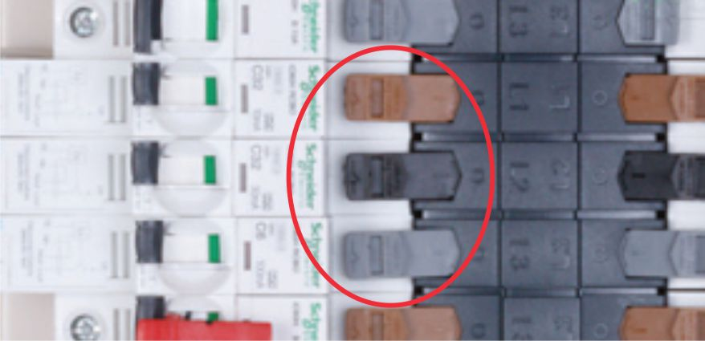

# Cryocooler no power

**<span style="font-size:large;color:maroon">Problem</span>**

<span style="font-size:medium">A SMS text message and email was received from the IHR at 9:24am on Saturday 9th February 2019, during re-install of MEG in CHBH.</span>

**```
Losing helium from helium gas storage tanks
```**

LJJ & MEGIN engineers had been **testing/replacing fuses** during the afternoon of Friday 8th February **to ensure the Cryocooler startup/inrush current didn't cause any trips**. <br />
After the MEGIN engineer had left, the **fuse was evidently rechecked** but the **switch disconnectors inside the fuse box (Schneider Electric SEA9BN8, IHR/Tank Room - G24) were evidently not moved back before the box was closed**. <br />
<span style="color:red">The trip was set, so nothing appeared to be amiss, **but the Cryocooler would not now have power!**</span>


**<span style="font-size:large;color:maroon">Solution</span>**

After a few frantic 'phone calls trying to get hold of the correct personnel, the LJJ engineer attended CHBH, reset the disconnectors in the fuse box, and power was restored to the cryocooler. 
The system was immediately put into Cooldown mode to reduce the tank pressures.

**<span style="font-size:large;color:maroon">In future, if this issue happens again (or with any fused equipment).</span>**

{width=55% align=right}

* Check the trip and reset if possible. If trip doesn't reset, contact Estates and/or MEGIN.
* Ask Estates to open up the fuse box to check the disconnectors.
* If they are set correctly, check mains power is getting to cryocooler.
* If no power to cryocooler, contact Estates/LJJ.
