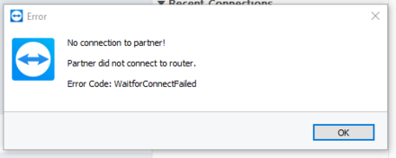

# "*Unable to connect to TeamViewer*" (but now to do with DNS Server Settings)

### **<span style="color:maroon">Problem</span>**

On attempting to access the IHR via TeamViewer on Monday 25th January 2021, the following error window was generated...



IT Services informed the University in 2020 that some DNS address changes were to take place. Those changes were made on the DACQ console **but apparently not on the IHR**. Evidently the old DNS Servers were still in use, 
and only recently (2021?) have IT Services finally decommissioned them. IHR access via TeamViewer was still available up until the final powering off of these old Servers.

### **<span style="color:maroon">Solution/s</span>**

MEGIN remotely accessed the DACQ console in order to debug the problem on the IHR. They solved the problem (thanks Ronny!) by changing the DNS addresses on the IHR to the same as those on the DACQ console...

**[MEGIN Fix](https://canvas.bham.ac.uk/courses/81128/files/folder/MEG?preview=22737441)**

After rebooting the IHR one final time, remote access was available again via TeamViewer.

* Occasionally the IHR may need a restart or reboot. If so, see **[To Logout or Restart the IHR](../../meg/troubleshooting/logout_restart_ihr.md)**


**<span style="font-size:large;color:blue">For any future DNS address changes, remember to change on DACQ, the WatchGuard FW, the IHR and the Stim PCs.</span>**


**<span style="font-size:large;color:red">May 2024</span>**

A **similar problem occurred on 2nd May 2024**, this time IT Services had informed the University that **ALL the old DNS Servers were being permanently switched off on that day**.<br />
Evidently, the IHR was still using some old Server addresses, "***old***" as being used back in 2021. TeamViewer threw up the same error window as above.

The file ***resolv.conf*** was edited on the IHR, via a Terminal window, using the VIM editor via **S**uper**U**ser**DO**, and the old DNS servers addresses were removed and the new ones added ...

**```
sudo vim /etc/resolv.conf
```**

**[new nameservers](https://canvas.bham.ac.uk/courses/81128/files/folder/MEG?preview=22737774)**

The settings were checked afterwards, using ...

**```
sudo /sbin/ifconfig
```**

... and, to be safe, the IHR was restarted afterwards, either by using ...

**```
sudo /sbin/reboot
```**

... or via the procedure detailed here, **[To Logout or Restart the IHR](../../meg/troubleshooting/logout_restart_ihr.md)** - (see the **Restart** section - **<span style="color:red">don't perform remotely!</span>**) .

The **WatchGuard FW DNS server settings** were also changed, and the new Server settings were **added manually to the DACQ Console eth1 (IPv4)** and to **the NEW and OLD Stims Ethernet settings (IPv4)**.
