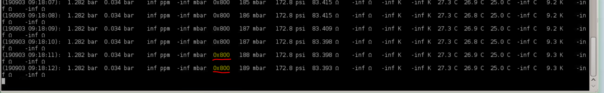

# IHR Status Codes

**Status Codes on IHR (seen in “Follow data log”, column 6)**

***“I had a look over TeamViewer, and the cryocooler status code is 0x8a0, 
which means that there is a cooling water flow issue which has caused the working gas temperature to rise. 
...Oh, now the code changed back to 0x800, meaning normal idle status. I'll try setting the system back to Normal mode… Oh, it failed again due to the same reason :( Please call someone to check the water circulation, Jonathan”***

**Antti Teliö - 29/08/2019 - *pumps were "0FF" on the day of the chiller service, when informed they wouldn't be (sigh!).***

 

**IHR Status Codes**

***“These codes (underlined in the image above) can be seen in the IHR “Follow data log”, column 6. 
The codes are from the Manufacturer, Sumitomo, and indicate the status of the compressor/cold head.
By adding the hexadecimals 0x800 + 0x080+  0x020 = 0x8a0 which actually means that the water flow is low 
and causes the work gas lines to heat up => fail safe mode => restart compressor when water cooling is working again”.***

**Henri Hautaniemi - 03/09/2019**

 
**From the NM25887A-B_TRIUX_neo_Corrective_Maintenance_Manual ...**

"***The cryocooler compressor reports errors in hexadecimal format and these values appear both in the cryodata
log file (column 6), and in error notifcations. The reported error condition is a sum of the bits below. This means
multiple bits may be present at a time.***"

!!! info "Normal - no errors - code is 0x800. In water flow/temperature problem cases the error codes are typically: 0x820, 0x840 or 0x420. Status and error bits are summed up to form the error codes. For example 0x8a0 means 0x800 (*cooler on*) + 0x020 (*water not flowing*) + 0x080 (*working gas overtemperature*)."

|  **Cryocooler compressor diagnostic interface codes**  |    |
|  -------------  |  -------  |
|  SUMITOMO_DIAG_LOW_PRESSURE_SHUTDOWN  |  0x001  |
|  UNCONNECTED  |  0x002  |
|  UNCONNECTED  |  0x004  |
|  UNCONNECTED  |  0x008  |
|  SUMITOMO_DIAG_POWER_ERROR  |  0x010  |
|  **SUMITOMO_LOW_WATER_FLOW**  |  **0x020**  |
|  SUMITOMO_DIAG_HIGH_WATER_TEMP  |  0x040  |
|  **SUMITOMO_DIAG_GAS_TEMP_ERROR**  |  **0x080**  |
|  SUMITOMO_DIAG_OIL_SHUTDOWN  |  0x100  |
|  SUMITOMO_DIAG_MOTOR_WINDING_TEMP  | 0x200  |
|  **The following two bits are not actual errors but are also summed to the reported value. The SUMITOMO_DIAG_RUN_STATUS bit being set indicates that the cryocooler compressor is running, and SUMITOMO_DIAG_SOLENOID_OPEN is the negation of SUMITOMO_DIAG_RUN_STATUS always. Hence, one of these bits should always be present, unless the cryocooler compressor is powered off, or the cable is disconnected**  |
|  SUMITOMO_DIAG_RUN_STATUS  | 0x400  |
|  **SUMITOMO_DIAG_SOLENOID_OPEN**  |  **0x800**  |

!!! info "02/05/2023 - Status code 0x420 - was seen during a IHR fail-safe error received that evening (7:26pm).   Based on the above codes, it would signify the cryocooler was in "*Run*" mode, but with "*Low Water Flow*", consequently generating the sent "*Error in cryocooler! Recycler is now in fail-safe mode*" SMS text and email."

