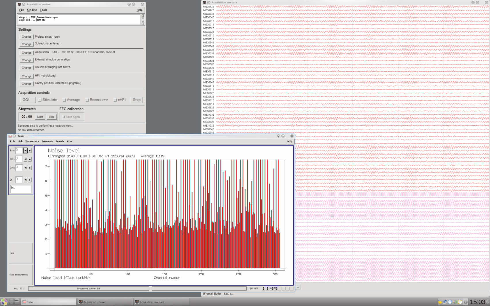
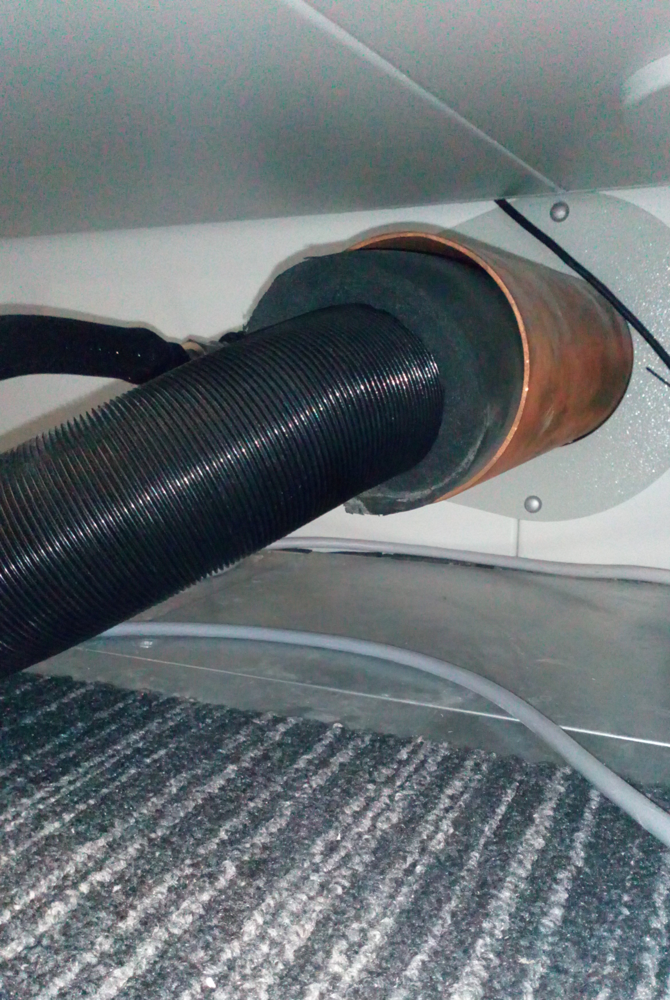

# MSR Exhaust Pipe Issue

{width=45% align=left}

**Problem**

The MSR Helium exhaust pipe was found to be disconnected from the main exhaust stack whilst checking on exhaust valve usage ready for a planned power shutdown on Juanary 15th.
On reattaching the pipe, the sensors were then found to be extremely noisy.  

{width=45% align=left}

**Solution**

After a TeamViewer chat with MEGIN, the noise was found to be caused by the exhaust pipe having been moved/pulled out slightly where it exits the MSR copper waveguide under the Filter cabinet at the back of the MSR.  
Carefully pushing the pipe back into the waveguide appeared to solve the noise problem.

**Ongoing problem**

Unfortunately the noise returned the following morning. The Jubilee clip holding the metal pipe to the plastic insert inside the waveguide was likely to be touching the copper, 
so insulation tape was wrapped around it and the pipe reinserted. The noise levels dropped to acceptable values and were stable throughout the day.

 
**January 2022**

Noise is still being seen on arrival first thing in the morning, and the pipe subsequently adjusted slightly (in or out, etc). 
Movement possibly caused by liquefaction vibration? Not an ideal situation or solution to be undertaken every day. MEGIN has been contacted.

**UPDATE: January 18th 2022**

**Ross Devlin, Senior Service Specialist, Customer Care Team.** 
*Visited site. 
Current noise level 2.4 ish. 
Unable to reproduce fault, in spite of seriously messing with the He exhaust. Deliberately grounded it against feedthrough, rubbed it vigorously on feedthrough tapped it on feedthrough etc. No significant impact on noise level throughout. 
The 60mm flexible He exhaust was not properly secured to the 100mm pipework (hoseclip missing). Tested noise with 60mm flexible He exhaust secured and detached... no significant difference in noise measurement. 
In conclusion, whatever the source of the noise (from the data very definitely 50Hz) is not present now.  
The flexible 60mm He exhaust is connected through the feedthrough using a non-conductive connecting sleeve so I suspect that it was coincidental that Jonathan's efforts seemed to 'resolve' the issue. 
Have secured 60mm flexible exhaust to 100mm pipework with hoseclip. Reinstated insulation applied by Jonathan, rechecked noise level (2.4). 
The system was left in working order. 
Agreed with Jonathan that I would close this case and we would open a new one if the problem recurs. *

