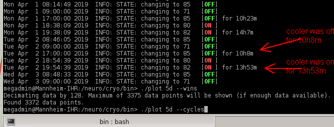

# MEG Usage time

**To see how much MEG usage time can be obtained ...   - via the IHR PC (Tank Room, G24) - not remotely!!**

- **Open** a terminal window (click on the **Konsole** Terminal button, lower left of the IHR window), then type ...

	- **megadmin@neptunus-20170801:/> cd /neuro/cryo/bin**
	!!! note "The default Terminal window on the IHR now opens to ...  "*megadmin@neptunus-20170801:/opt/neuromag/cryo/bin>*"  so the above "cd (change directory)" may not be needed."
	- **./plot 7d --cycles** - lists cryocooler state changes and times (85 => turn off, 80 => turn on)
	- **./plot 7d --wins**  - plots windows (on top are the boil-off times, the same cooler-off times as with cycles.

**See [IHR Plot usage](../../meg/troubleshooting/ihr_plot_usage.md) for other uses of the "plot" command.**

**IHR Cycles**

!!! info "As the tanks only get half full during the day (~5bar), some extra capacity is achievable by letting the tank pressure accumulate Mon - Fri, so that the cryocooler can liquefy the full tanks over the weekend (or Sunday).   The extra capacity varies 1-2.5 hr/day, depending on the gantry position and cold head performance."
 
**What to set the Scheduler to, if acquisition not taking place e.g. Sundays.**

***“Instead of using those "None" windows, nowadays we recommend to set the windows to their minimum length of 1 hour. 
The reason is that if you have multiple None days in a row, the system lets the tanks accumulate until 9 bars before starting to liquefy. 
Then if it happens that someone would happen to need the system earlier than expected, the tanks might get overfilled before the unexpected measurement finishes.”***

**Antti Teliö, 09/01/2020**

